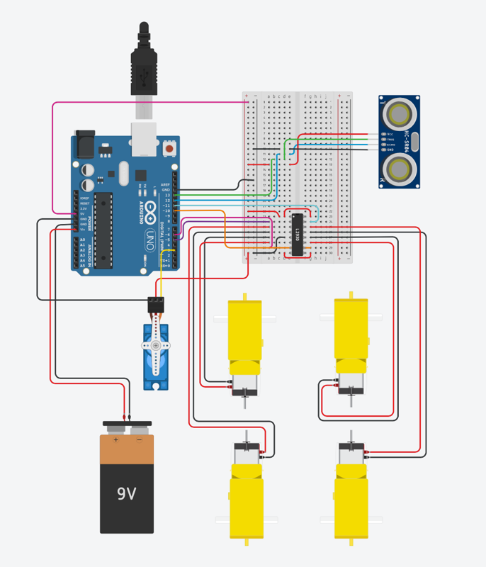
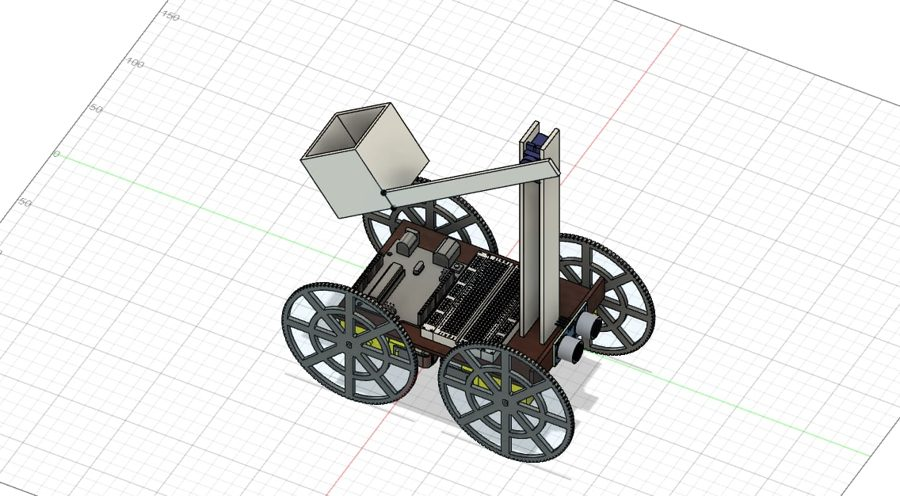
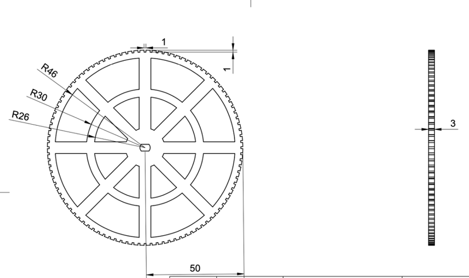
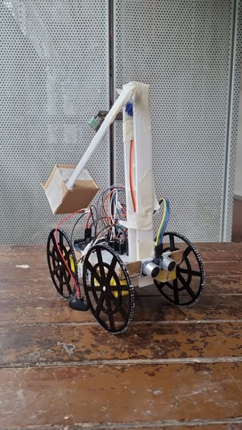

# Autonomous Robot

**A four-wheeled robot that crosses an obstacle course on its own and lobs a ping-pong ball over
a wall.** 
Arduino Uno, four geared DC motors on laser-cut acrylic wheels, an ultrasonic sensor and a
servo-driven arm, iterated through ten prototypes. For NUS EG1311 *Design and Make*, in a team
of six.

> [!NOTE]
> This consolidated README page was added by
> [Claude Opus 5.5](https://docs.anthropic.com/en/docs/claude-code) in Nov 2026 using my
> [agentic-repo-analysis](https://github.com/sp4ce-cowboy/agentic-workflows) skill, from the
> project's code and the team's report. The project itself is from Aug – Nov 2022. The original
> README is in **[README-ORIGINAL.md](README-ORIGINAL.md)**; the full report is
> **[B15 Team2 Report.pdf](B15%20Team2%20Report.pdf)**.

## At a glance

| | |
|---|---|
| **What** | A robot that drives an obstacle course (a slope and obstacles), stops short of a wall without touching it, and delivers a ping-pong ball over the wall |
| **Context** | NUS [EG1311](https://nusmods.com/courses/EG1311/design-and-make) *Design and Make*, AY2022/23 Semester 1 (Aug – Nov 2022) |
| **Stack** | Arduino Uno in C++, an ultrasonic sensor, four geared DC motors, a servo; laser-cut acrylic, cardboard; Fusion 360 and Tinkercad |

 

## How it was built

Four stages, each with its own prototypes, from the [report](B15%20Team2%20Report.pdf):

| Stage | Prototypes | What changed and why |
|---|---|---|
| 0. Template | 0 | Assembled the course's template robot and changed its code to stop 5 cm from the wall instead of 30 |
| 1. Vehicle | 1.1 – 1.5 | Two cardboard wheels lacked grip on the slope; four wheels veered because hand-cut wheels differed. Laser-cut acrylic wheels fixed the size, sanded and hot-glued rims fixed the grip, and 8-spoke reinforced wheels survived the axles. A cardboard body proved stiff enough and lighter than acrylic |
| 2. Arm | 2.1 – 2.2 | A spring-loaded catapult couldn't hold its tension on the servo blade, so it was replaced by a servo arm that swings a basket 135° over the wall |
| 3. Final | 3.1 – 3.2 | Merged the arm's code into the vehicle's; rebuilt the robot when the body sagged, motors loosened and wires came out; moved the battery back after a topple |

**The code** ([`sketch_sep28a.ino`](https://github.com/sp4ce-cowboy/autonomous-robot/blob/cba5c551a1c974923474edaca49e4b6509820a56/sketch_sep28a.ino#L26-L54)):
each loop pings the ultrasonic sensor and converts the echo to centimetres. Far from the wall, all
four motors run and the arm stays up; within 7 cm, the motors stop. The arm only deploys if the
robot has also been on for more than 10 seconds (a `millis()` buffer), because the team used the
sensor to stop the robot by hand before a run, which would otherwise have thrown the ball at the
start line.

From the report's appendix:

| Tinkercad circuit | Fusion 360 model |
|---|---|
|  |  |
| **Wheel drawing** (8-spoke, laser-cut acrylic) | **The final robot** |
|  |  |

The specification, dimensioned drawings and the final run's video are in
[README-ORIGINAL.md](README-ORIGINAL.md).

## Skills shown

| Skill | Where it shows (click the links for the code) | Docs |
|---|---|---|
| **Embedded control**  | Ultrasonic ranging, motor and servo control, a start-up buffer: [`loop`](https://github.com/sp4ce-cowboy/autonomous-robot/blob/cba5c551a1c974923474edaca49e4b6509820a56/sketch_sep28a.ino#L26-L54) | [Servo library](https://docs.arduino.cc/libraries/servo/) |
| **Mechanical design and prototyping** | Ten prototypes across wheels, body and arm: [report](B15%20Team2%20Report.pdf), sections 3 – 6 | |
| **CAD and fabrication** | Fusion 360 model, dimensioned drawings, laser-cut acrylic wheels | [Fusion 360](https://www.autodesk.com/products/fusion-360/overview) |
| **Circuit design** | Tinkercad circuit for the Uno, motors, sensor and servo | [Tinkercad Circuits](https://www.tinkercad.com/circuits) |
| **Teamwork** | Six people building the vehicle and the arm in parallel on separate Arduinos, then merging | |

## On our resumes

**Skills:** Arduino · embedded C++ · ultrasonic sensing · DC motor and servo control · Fusion 360 · laser cutting · rapid prototyping

- Built an autonomous four-wheeled robot in a team of six on an Arduino Uno that crosses an obstacle course, stops short of a wall with an ultrasonic sensor, and swings a servo arm to deliver a ball over it.
- Iterated through ten prototypes in four stages, solving traction on a slope with laser-cut, sanded and glue-rimmed acrylic wheels, and replacing a failed spring catapult with a 135° servo arm.
- Merged two separately developed Arduino programs (vehicle and arm) and added a `millis()` start-up buffer so the arm can't deploy before a run begins.
- Modelled the robot in Fusion 360, drew its circuit in Tinkercad and produced dimensioned drawings and a 15-page design report.
